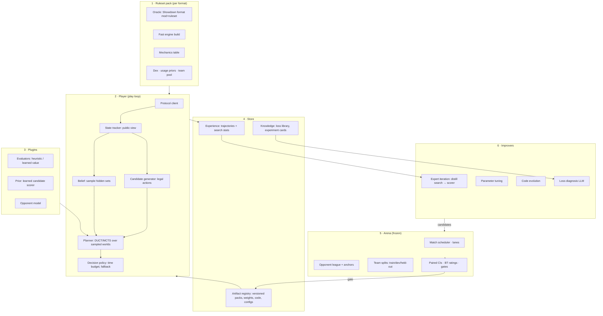
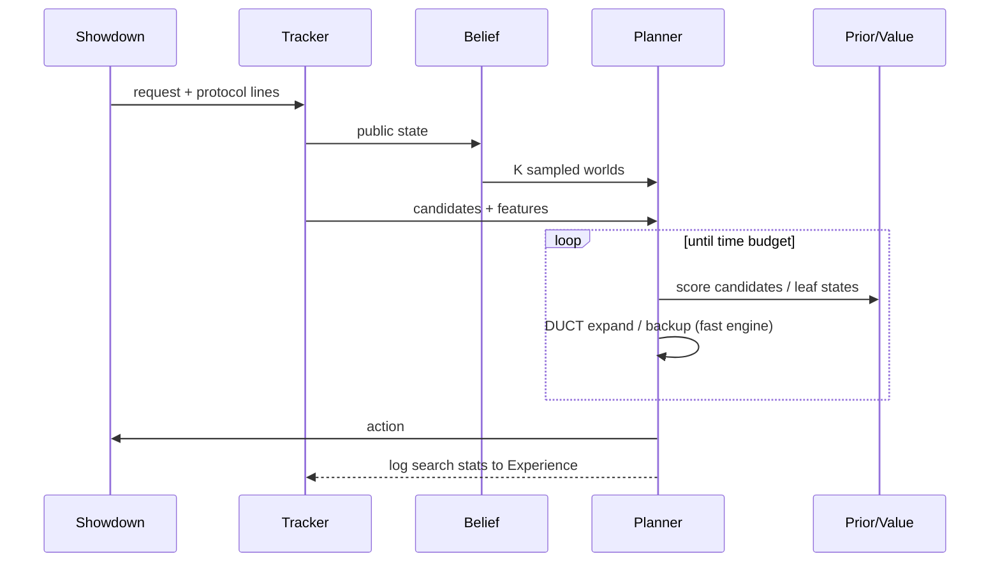

# Harness design (draft, branch `harness`)

Status: design for discussion. Nothing in it is implemented yet. Evidence: `reports/harness_research.md`.

## 1. What the harness is

A harness that **plays** a turn-based game under a given ruleset and **improves itself** between games. The verifier is win rate in an exact simulator.

Three nested loops, each at a different time scale:

| Loop | Time scale | Who decides | What changes |
|---|---|---|---|
| **Play** | one decision (≤ 1–5 s) | search + small model | nothing persistent; the action is chosen |
| **Learn** | hours | automatic pipeline | model weights (expert iteration), set priors |
| **Research** | days | LLM agent + human gate | code: evaluator, belief filters, adapters, search settings, training recipe |

## 2. Components

### 2.1 Ruleset pack: everything game-specific
- **Oracle:** a Showdown format (`mod: genN` + ruleset + banlist). It is exact but slow. It is used for real battles and for checking the fast engine.
- **Fast engine:** poke-engine, one build per gen. It provides `legal`, `outcomes(state, a1, a2) → [(p, state')]` and `damage`.
- **Mechanics table:** per-gen facts that matter for hidden information (team preview, paralysis divisor, permanent weather…). Pattern: FoulPlay's `GenerationMechanics`.
- **Data:** dex, usage priors per format and month, and team pools split into train, dev and held-out.
- **Contract:** a pack is accepted only when its differential tests pass, i.e. the engine agrees with the oracle on N recorded states.

### 2.2 Player: the play loop
- **Protocol client:** live server or offline sim. This is the existing `NeuralPlayer`/runner plumbing.
- **State tracker:** public information only; the leakage rules still apply.
- **Candidate generator:** legal actions from the request, each with engine-computed features.
- **Belief:** samples K opponent worlds from usage priors, filtered by in-battle inference (Boots, Assault Vest, speed bounds, damage back-solving…).
- **Planner:**
  - DUCT/MCTS over the K worlds, then merges their visit policies;
  - Evaluator and Prior are plugins;
  - the time budget is per decision.
- **Decision policy:**
  - commits the action;
  - on timeout or error falls back to the prior's argmax, then to a heuristic;
  - logs everything to Experience.

### 2.3 Plugins: the swappable intelligence
- **Evaluator:** turns a leaf state into a value. Versions: v0 hand-written (FoulPlay-like), v1 learned value head, and possibly a mix.
- **Prior:** the Jev-like candidate scorer. Input is the state plus the candidate list; output is P(candidate). It orders and prunes moves inside search.
- **Opponent model:** P(opponent action), P(opponent set). It sharpens both belief and search.
- Every plugin has the same interface in every pack. Plugins that are trained carry a `pack_compat` list.

### 2.4 Store: the memory
- **Artifact registry:** every runnable configuration is a manifest. It lists the pack version, engine build hash, plugin versions, weights sha256, config and the git commit. Play and the arena only load from the registry.
- **Experience:** per-decision trajectories, including search visit counts, root values and belief samples. This is the training data for the Learn loop.
- **Knowledge:**
  - a loss library (classified losses with replay links);
  - experiment cards;
  - a decision log.

  This is the memory of the Research loop (cf. CLAUDE.md / notes in coding agents).

### 2.5 Arena: the frozen judge
- It runs paired matches (same teams, both directions) with lanes and memory caps.
- **Opponent league:**
  - fixed anchors: KK, Kakuna, FoulPlay if installed, GymLeader;
  - the current champion;
  - recent candidates.
- Team splits are sealed: dev is for selection, held-out is used once per promotion.
- It outputs paired CIs and Bradley–Terry ratings, applies the gate rules and writes a promotion record.
- **No improver can write to the arena code, configs, team splits or results.** This is enforced by file permissions and checksums, not by trust.

### 2.6 Improvers: how it gets better

| Improver | Input | Output | Verifier |
|---|---|---|---|
| **Expert iteration** | Experience (search targets) | new prior/value weights | arena: search+new model vs search+old model, at equal time |
| **Parameter tuning** | search config space (K worlds, c_puct, budget split, evaluator weights) | config | arena (bandit / successive halving on dev) |
| **Code evolution** | evaluator / belief filter / adapter source + failing cases | code diff | unit tests, differential tests, then arena |
| **Loss diagnosis (LLM)** | loss replays + search logs | hypothesis + experiment card | the human approves; then one of the above runs it |
| **Data refresh** | new usage stats, new teams | updated priors / pools | belief log-likelihood on recent replays, then arena |

## 3. Main flows

### 3.1 Play: one decision

### 3.2 Learn: overnight, automatic
1. Self-play and league games run with the current champion, using the search budget.
2. The decisions' search targets (visit distributions, root values) are written to Experience.
3. The scorer is distilled toward the targets, with a KL anchor to the previous scorer.
4. The arena compares new and old on dev at equal time per move. The new scorer is promoted only if the CI is above 0.
5. Repeat.

### 3.3 Research: an LLM-driven outer loop, human-gated
1. **Observe:** collect the loss library, the worst decision clusters and the slowest components.
2. **Hypothesize:** the LLM writes an experiment card (hypothesis, the one file it changes, budget, gate).
3. **Implement:** the LLM edits only whitelisted files (evaluator, belief filters, adapters, train recipe) inside a git worktree.
4. **Verify:**
   - unit and leakage tests;
   - differential tests;
   - arena dev run.
5. **Decide:** keep or revert, and append the result to the experiment log.
6. **Promote** to held-out and the registry only with human approval.

This is karpathy/autoresearch generalized from "one file + val loss" to "a whitelist of files + arena gate".

### 3.4 New ruleset: e.g. gen 9 → gen 4
1. Build the pack: engine build gen4, mechanics row, dex, usage priors, team pool (train/dev/held-out).
2. Differential tests, engine vs Showdown `[Gen 4] OU`. Fix or flag any gaps.
3. **Zero-shot:** run the existing player unchanged. Plugins that are not `pack_compat` drop to their heuristic versions.
4. The arena measures it vs the gen-4 anchors (Metamon gen4 agents, heuristics).
5. **Adapt:** run the Learn loop on the new pack, with the scorer initialized from the gen-9 scorer.

## 4. Is it like a coding tool? Yes, in structure.

| Coding agent harness (Claude Code, omp) | This harness |
|---|---|
| LLM chooses the next action | Planner + small model choose the next move |
| Tools (read/edit/bash) | Fast engine, damage calc, belief sampler |
| Context window + compaction | Tracked public state + belief |
| `AGENTS.md`, skills | Ruleset pack + mechanics table |
| Test suite / CI | Arena |
| Permissions, hooks | Write scopes; frozen arena; leakage tests |
| Subagents, parallel tasks | Search workers, arena lanes |
| PR review → merge | Promotion gate → registry |
| Session memory / notes | Experience + knowledge store |

**Differences:**
- **Inner loop speed.** A coding agent spends seconds to minutes per step; the play loop must decide in ~1–5 s, many thousands of times. So the LLM is not in the play loop.
- **Verifier.** Code has tests (pass/fail). Games have win rate, which is cheap and exact per game but noisy, so the gates need many paired games and CIs.
- **The Research loop _is_ a coding-agent harness.** An LLM agent edits code under tests. We can run it on an existing coding agent (omp/Claude Code) with a `program.md`, as `autoresearch/` already does, instead of building our own agent runtime.

## 5. Reference harnesses

| Reference | What we take |
|---|---|
| FoulPlay / poke-engine | the pack split, determinized DUCT, set inference filters, the `GenerationMechanics` table |
| OpenSpiel | the game/state interface (`legal_actions`, chance outcomes, simultaneous moves); `LoadGame("name(params)")` → our pack loading |
| AlphaZero / Expert Iteration | the Learn loop |
| karpathy/autoresearch (already in repo) | the Research loop: frozen evaluator, bounded edit scope, fixed budget |
| AlphaEvolve / ShinkaEvolve | the code evolution improver: program archive, novelty filter |
| Continual Harness (Gemini Plays Pokémon), PokéAgent RPG harnesses | the knowledge store, verification and reflection sub-steps, compaction |
| Darwin Gödel Machine, AI Scientist | what to forbid: self-edited evaluators and limits, fabricated logs |
| Metamon | versioned observation/backends, the team-set discipline |

## 6. Decisions needed from the user

1. **Scope of "not tied to one game":**
   - (a) all Pokémon gens/formats, with generic interfaces;
   - (b) any turn-based game, i.e. an OpenSpiel-style layer and a second, non-Pokémon game as proof.

   Recommended: (a), with interfaces kept OpenSpiel-shaped so (b) stays possible.
2. **Research-loop LLM:** which model and budget. Should it run unattended overnight, or only on request?
3. **Promotion:** is human approval always required? Recommended: yes for registry promotion; dev-only experiments run automatically.
4. **FoulPlay as an anchor:** install it locally (GPL, measurement only, not in the repo)?
