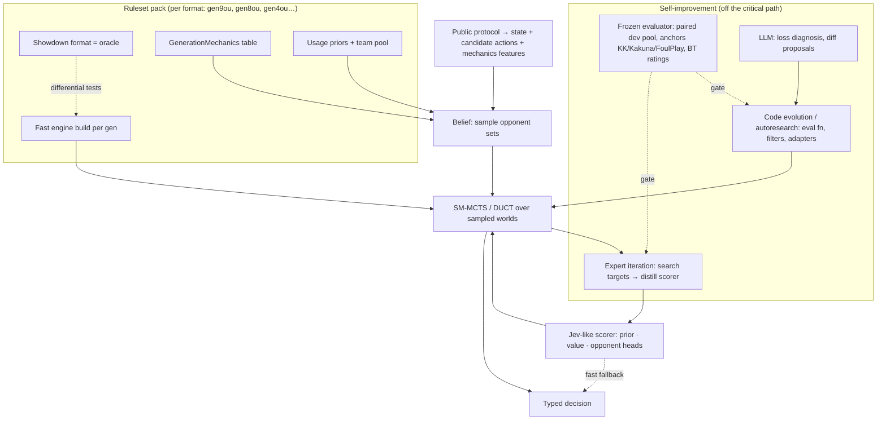

# Pivot study: from "a model" to a self-improving, ruleset-agnostic game harness

*20/10/2026 | Sources: 24 | Confidence: Medium (several numbers are self-reported; marked SR)*

## Question

The user's proposal:
- **Jev-like decision model.** It should switch game mechanics dynamically (gen 9 → 8 → 7 …) without retraining.
- **Harness built for self-improvement.** Search is one capability among several, and the harness is not tied to one game.

This study asks three things:
- Is the proposal realistic?
- What does the evidence say?
- How should the harness be built?

## Executive summary

- **Generality across rulesets is achievable today, but it lives in the harness, not in the network.**
  - FoulPlay plays gens 1–9 with no training at all. It needs only a per-generation engine and per-format set priors, and reaches gen9ou 80% GXE (SR) [1][2].
  - Every learned agent in the literature is trained per game or per generation. That holds for Metamon, AlphaZero, Student of Games and Polygames [3][4][5][6].
  - No source shows zero-shot transfer of a learned policy to new Pokémon mechanics [3][7].
- **"Jev-like" models (Jev, Kev, Nimble, tev1, Laya) generalize to new option sets by reading rules as text** through a ≥0.3B pretrained LM [8][9][10][11][12].
  - At small size this breaks down: Kev-0.8B is ~20 points behind Kev-27B on unseen policies (SR) [9].
  - Order sensitivity is a documented failure mode [12][13].
  - A 1M network cannot "read" a new ruleset. It can only consume mechanics computed for it.
- **Learned components are best as a prior, value and belief inside search**, plus a fast fallback, not as the player.
  - Jaxcalibur (8.5M, self-play PPO, randbats only): search adds only +100–150 Elo on top of a strong net (SR) [14].
  - FoulPlay: search without a network reaches 80 GXE. Its author rates set prediction as important as search [1].
- **Self-improvement loops that are proven in comparable settings:**
  - expert iteration (search → distill) for weights [15];
  - frozen-evaluator code evolution for non-differentiable parts (AlphaEvolve/ShinkaEvolve pattern, karpathy autoresearch) [16][17][18];
  - LLMs off the critical path, proposing diffs and diagnosing losses [7][19].
- **Per-move LLM play is not competitive on the ladder timer.** At 60–90 s, LLM agents lost on time or fell back to simpler play, and cost up to $1.25 per game. All top finishers in the challenge were RL or search agents [7].

## 1. What "Jev-like" really is, and what it can transfer

| System | Backbone | How new options/rules enter | Transfer evidence |
|---|---|---|---|
| Jev (TypeSafe, closed) | undisclosed; probing suggests a causal LM with a listwise option head [13] | state + typed questions (`choice`/`score`/`noul`) as text [8] | no rule-swap claim; calibration ECE 0.031 on MMLU in probing [13] |
| Kev | Qwen3.5 0.8B–27B | schema in prompt, logits over option tokens [9] | 27B 0.85 / 0.8B 0.65 on new sources (SR) |
| Nimble | Qwen3.5-9B LoRA | one-token codes per answer [10] | 90.1% agreement (SR, synthetic labels) |
| tev1 | Qwen3.5-4B LoRA | lettered options [11] | 300/300 "policy transfer" (SR, reused dev sets) |
| Laya | ModernBERT 322–421M encoder | typed questions over text; option-reorder stability hook [12] | 0.77 fine-tuned vs 0.36 base |

The transferable ingredient is the **interface**:
- typed decision over an explicit candidate set;
- one forward pass;
- calibrated probabilities.

The **backbone** does not transfer: rule-reading needs an LM. Rule-text conditioning outside Pokémon (EMMA) gives only partial zero-shot transfer [20]. Chess-variant studies show that legality transfers better than strategy [21]. Legality is free in our setting, because the engine supplies the mask.

## 2. Where mechanics should live

| Option | Exact? | Speed | Gens | Per-gen switch |
|---|---|---|---|---|
| Showdown sim (`data/mods/genN`, format = `mod` + `ruleset` + `banlist`) | the practical standard (not cartridge-exact) [22] | slow: ~60 ms per RBY battle even stripped (SR, pkmn benchmark) [22] | 1–9 + variants | config only |
| poke-engine (Rust, MIT) [2] | approximate; README: "not perfect" | ~250k MCTS iterations/s (one README example) | 1–9 via Cargo features | **rebuild per gen** (one wheel per gen) |
| pkmn/engine (Zig, MIT) [22] | bug-for-bug exact | ~3000× faster than PS (SR) | 1–2 only, pre-v0.1 | n/a yet |

poke-engine details [2]:
- Its MCTS takes **no evaluator or prior argument**; `evaluate.rs` is hard-coded per generation.
- The reusable hooks are `generate_instructions(state, m1, m2)` (all outcomes with probabilities) and `calculate_damage`.
- A learned prior or value therefore needs our own simultaneous-move MCTS on top of those hooks, or a fork.

FoulPlay keeps hidden-information rules per generation in a frozen `GenerationMechanics` dataclass (paralysis divisor, permanent weather, team preview…) and derives each older gen with `replace(...)` [1][2]. Set priors come from Smogon usage stats per format, forum teams and replays, filtered by in-battle inference [1].

**Design rule [INFERENCE]:** mechanics form a **ruleset pack**:
- the Showdown format id as the oracle;
- an engine build;
- the `GenerationMechanics` table;
- dex data;
- usage priors;
- a team pool.

Everything above the pack is ruleset-agnostic. Showdown is the oracle that the fast engine is **differentially tested** against, as pkmn/engine does with Showdown logs [22].

## 3. Self-improvement: what improves, and what verifies it

| Loop | What changes | Verifier | Fit for us |
|---|---|---|---|
| Expert iteration / AlphaZero [15] | weights (prior/value) | game outcome + search targets | **core**: cheap exact simulator, 16 threads, RTX 3060 |
| autoresearch [18] | one editable file, fixed 5-min budget, frozen evaluator | single frozen metric | already in repo (`autoresearch/`); reuse with a win-rate gate |
| AlphaEvolve / ShinkaEvolve / FunSearch [16][17] | code (eval function, move ordering, inference filters, adapters) | automated scorer + program archive + novelty filter | good for the hand-coded evaluator and set filters |
| Darwin Gödel Machine [23] | the agent's own scaffold | benchmark score | documented **objective hacking** (fabricated tool logs) |
| Continual Harness (Gemini Plays Pokémon) [19] | prompts, sub-agents, skills, memory, without resets | game progress | the harness alone recovered most of the gap to an expert harness (SR) |

Failure modes to design against:
- An agent editing its own limits or evaluator [23].
- Overfitting to a single opponent. Use a league plus held-out opponents and teams [6][7].
- Noisy ladder Elo. The challenge used full-history Bradley–Terry instead [7].

## 4. Proposed harness

The scorer must change from the current 13-slot design to a **candidate scorer**:
- Today, KK consumes Metamon's gen9ou vocabulary and a fixed 13-slot action space.
- To run under any pack, it should score an explicit candidate list, where each candidate carries engine-computed features (damage %, KO probability, speed order). This is the Jaxcalibur matchup-token idea [14].
- Training should be order-invariant.

W8 E1 showed that such features add nothing to a distilled policy. In this design, their job is different: they make the scorer **ruleset-portable**, not stronger [INFERENCE].

What can be claimed, in tiers [INFERENCE]:

| Tier | Claim | Evidence it is feasible |
|---|---|---|
| A, zero-shot, new pack | legal play, plus search strength driven by engine + priors | FoulPlay across gens [1] |
| B, few-shot | the scorer is adapted by expert iteration on the new pack (hours, not a full retrain) | ExIt [15]; no Pokémon cross-gen data yet |
| C, full retrain | only for long-horizon strategic priors | Metamon retrained per gen [3] |

## 5. Repo assets that carry over

| Asset | Role in the harness |
|---|---|
| `src/pokeai/cf/sim_driver.js` (snapshot/restore/PRNG over pinned Showdown) | oracle backend and differential tests |
| `src/pokeai/cf/belief.py` (usage-prior set sampler) | belief layer; add FoulPlay-style inference filters |
| `src/pokeai/cf/reconstruct.py`, `recon_world.py` | public protocol → world state; needs an engine-state exporter |
| `src/pokeai/agents/live_search.py`, `recon_search.py` | search lifecycle, deadline, worker pool; the algorithm is replaced by DUCT on the fast engine |
| `scripts/evaluate_w5.py`, `run_metamon_h2h.py`, `w8_pairs.py` (paired, lanes) | frozen evaluator |
| `autoresearch/` | experiment loop template |
| Showdown `data/mods/gen1..gen9` in the pinned server | ruleset oracles for every generation |

Missing pieces:
- A fast engine (poke-engine, one wheel per gen).
- Team pools for gens other than 9 and 1–4. Metamon ships some; gen 8/7 still need building.
- Usage priors per format.
- A candidate-based scorer.

## 6. Recommended next steps

Each step ends at a gate.

1. **Interfaces + gen9ou engine.**
   - Add poke-engine (gen9 build) behind a `World` interface: `legal`, `outcomes`, `evaluate`.
   - Gate: agreement with Showdown on ~1k dev states, and nodes/s measured.
2. **Search-only harness on gen9ou**: DUCT + determinization + belief filters, with the hand-written evaluator.
   - Gate: paired dev win rate vs KK, Kakuna and GymLeader.
3. **Ruleset portability test**: same harness, no code change, on a second pack (gen4ou, since Metamon has gen 4 teams and data).
   - Gate: it plays legally, and its strength vs the gen4 heuristics and Metamon gen4 agents is measured.
   - This is the first real test of the user's "change mechanics without retraining" goal.
4. **Learned scorer as prior/value** (candidate-based), trained by expert iteration from step 2's search.
   - Gate: search+scorer beats search-only on dev at an equal time budget.
5. **Self-improvement loops on top**:
   - code evolution of the evaluator and filters under the frozen evaluator;
   - LLM loss-diagnosis.
   - External read-out: a short ladder run on fixed sample teams.

Main risks:
- poke-engine mechanic gaps, which step 1 measures.
- Set-prior quality in open formats, the dominant factor per FoulPlay [1].
- Goodhart on the internal evaluator. Mitigate with held-out teams and opponents plus ladder spot checks.

## Gaps

- No measured poke-engine throughput or agreement rate; its open issues were not read.
- No FoulPlay gen 6/7/8 OU results.
- AlphaEvolve, FunSearch, Voyager and Eureka figures were not re-fetched, so they are omitted above.
- Metamon's per-generation conditioning mechanism was not found in the sources read.

## Sources

[1] [Foul Play write-up (P. Mariglia)](https://pmariglia.github.io/posts/foul-play/): MCTS/DUCT, set prediction, per-format GXE (SR).
[2] [poke-engine](https://github.com/pmariglia/poke-engine) / [foul-play](https://github.com/pmariglia/foul-play): Cargo features per gen, Python API, hard-coded evaluate, `GenerationMechanics`.
[3] [Grigsby et al., Human-Level Competitive Pokémon via Scalable Offline RL (RLC 2025)](https://arxiv.org/abs/2504.04395): per-gen training, ladder GXE.
[4] [MuZero / AlphaZero (DeepMind)](https://deepmind.google/blog/muzero-mastering-go-chess-shogi-and-atari-without-rules/): given vs learned rules, per-game training.
[5] [Student of Games](https://arxiv.org/abs/2112.03178): one algorithm, per-game networks.
[6] [VGC-Bench](https://arxiv.org/html/2506.10326v3): more training teams → less exploitable but weaker per team.
[7] [PokéAgent Challenge (NeurIPS 2025)](https://arxiv.org/pdf/2603.15563v2): RL/search beat LLMs, timer effects, BT ratings, harness lessons.
[8] [TypeSafe: System One Models & Jev](https://typesafe.ai/blog/introducing-system-one-models-and-jev) and [API docs](https://docs.typesafe.ai/api/system-one).
[9] [Kev](https://github.com/jaredpalmer/kev): open Jev-style models, size vs transfer.
[10] [Nimble](https://github.com/bespokelabsai/nimble): token-code scorer, contrastive data.
[11] [tev1](https://github.com/togethercomputer/tev1): lettered-option decision model.
[12] [Laya](https://github.com/NandhaKishorM/laya): encoder decision model, option-order stability hook.
[13] [Archer Hume, "Jev's architecture unmasked"](https://archerhume.com/posts/jevs-architecture-unmasked): API probing (inferred architecture).
[14] [Jaxcalibur](https://jaxcalibur.github.io/): 8.5M self-play PPO, matchup tokens, aux heads, search +100–150 Elo (SR).
[15] [Anthony et al., Expert Iteration (NeurIPS 2017)](https://proceedings.neurips.cc/paper_files/paper/2017/hash/d8e1344e27a5b08cdfd5d027d9b8d6de-Abstract.html).
[16] [AlphaEvolve (DeepMind)](https://deepmind.google/discover/blog/alphaevolve-a-gemini-powered-coding-agent-for-designing-advanced-algorithms/): evolved code with automated evaluators.
[17] [ShinkaEvolve](https://arxiv.org/html/2509.19349v1): sample-efficient code evolution, novelty rejection.
[18] [karpathy/autoresearch](https://github.com/karpathy/autoresearch): one file, fixed budget, frozen metric.
[19] [Continual Harness](https://arxiv.org/abs/2605.09998): self-refining harness in Pokémon RPGs.
[20] [EMMA, rule-text-conditioned policies](https://arxiv.org/abs/2101.07393): partial zero-shot transfer to new dynamics.
[21] [ICML 2026 chess-transformer OOD study](https://icml.cc/virtual/2026/poster/64845): legality transfers, strategy weaker than search.
[22] [pkmn/engine](https://github.com/pkmn/engine) and its [TESTING.md](https://raw.githubusercontent.com/pkmn/engine/main/docs/TESTING.md): exact fast engine (gen 1–2), Showdown speed comparison, differential testing.
[23] [Darwin Gödel Machine](https://arxiv.org/html/2505.22954v3): scaffold self-modification, objective hacking.
[24] [Smogon Showdown data/mods](https://github.com/smogon/pokemon-showdown/tree/master/data/mods): per-gen mechanics via `mod` + `ruleset`.
