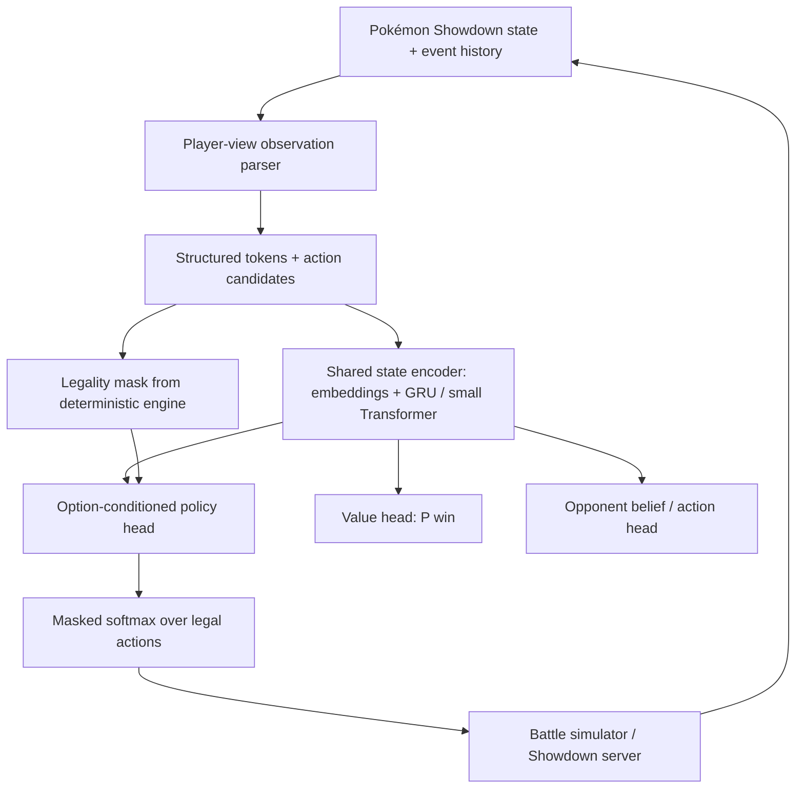

# Building a Jev-like Pokémon Showdown AI

*Technical research & design proposal — Nghiên cứu model quyết định, kiến trúc đề xuất, chiến lược train và lộ trình triển khai cho Gen 9 OU Singles.*

> **Kết luận khuyến nghị.** Xây một structured-state actor–critic nhỏ với option-conditioned action scorer, value head và opponent head. Dùng Metamon làm nền tảng dữ liệu/đánh giá; tham khảo Kev và Laya cho cách tính xác suất hành động, Jaxcalibur cho self-play và hidden-information modeling.
>
> **Hướng W6+ (19/10/2026).** Small, fast, outcome-driven decision model. Giữ C (GRU 1,3M) làm champion; không đổi backbone, không tăng tham số. Chỉ số quan trọng nhất là sức chơi của neural policy **một lần inference, không search**; search, heuristic và simulator chỉ là teacher khi train. W6-A (opponent head) và W6-B (distillation) là hai giả thuyết độc lập, không chặn nhau; W6-C chỉ thiết kế. Chi tiết ở §8.
>
> **Định nghĩa “Jev-like”.** Một model nhỏ, non-generative, nhận structured observation và đưa ra legal decision trực tiếp, với chất lượng quyết định được cải thiện nhờ outcome-driven learning. Opponent head, Q critic và search distillation là công cụ để đạt mục tiêu đó, không phải head bắt buộc; một head chỉ được giữ khi nó làm fast policy chơi tốt hơn hoặc làm teacher rẻ/tốt hơn.

**Phạm vi:** Pokémon Showdown · Gen 9 OU Singles (kiến trúc mở cho format khác) · RTX 3060 12 GB + 16 threads · practice bot + research benchmark trên local server  
**Cập nhật:** 19/10/2026 (W1–W5 xong; roadmap W6+)  
**Mức độ xác minh:** Ưu tiên paper peer-reviewed, README và model code chính chủ; phân biệt kết quả nhóm tác giả công bố và mục tiêu dự kiến.

## 1. Executive summary

Có thể tự build và train một model theo tinh thần “System One” để chơi Pokémon Showdown. Bài toán hợp với mô hình ra quyết định trực tiếp hơn là LLM tạo văn bản vì mỗi lượt có một tập action hợp lệ, battle state có cấu trúc, và có thể đo kết quả bằng win/loss. Tuy nhiên, xác suất chọn hành động không đồng nghĩa với xác suất hành động đó sẽ đem lại chiến thắng.

Khuyến nghị ưu tiên Gen 9 OU Singles trong phiên bản đầu tiên. Format này được Metamon hỗ trợ, cùng replay datasets, action space 13 lựa chọn cho lượt đấu thông thường, pretrained baseline và training/evaluation scripts \[06\]. Nếu muốn chuyển sang Gen 9 Random Battle, cần thay dữ liệu và giao diện môi trường; Jaxcalibur chỉ là tham khảo phương pháp, không phải checkpoint công khai \[08\].

> **Quyết định kiến trúc.** V0: state encoder + GRU (hoặc Transformer nhỏ) + masked action scorer + value head. V1: thêm opponent head và self-play league. V2: bổ sung search có điều kiện khi gặp vị trí chiến thuật khó. Không cần fine-tune LLM 4B–9B ở giai đoạn đầu.

### Các phát hiện đáng tin cậy

Jev của TypeSafe giới thiệu typed decisions và calibrated probabilities; trọng tâm là giao diện suy luận, còn chi tiết backbone/weights chưa công bố đầy đủ \[01\].

Kev, Laya, Nimble và tev1 công bố code/weights/recipe cho decision modeling; phần lớn benchmark là classification trên văn bản, không chứng minh năng lực chơi Pokémon \[02–05\].

Metamon cung cấp 5M+ reconstructed human trajectories, 20M+ self-play trajectories và 40+ baseline policies theo repo hiện tại \[06\].

Jaxcalibur công bố policy 8,5M tham số, PPO tự đấu và search khi inference; tác giả chưa phát hành weights/source, hiệu năng công bố thuộc Gen 9 Random Battle, không trực tiếp so với Gen 9 OU \[08\].

## 2. Model landscape và mức độ liên quan

| **Project**               | **Cái có thể học**                                                              | **Lưu ý quan trọng**                                                                           |
|---------------------------|---------------------------------------------------------------------------------|------------------------------------------------------------------------------------------------|
| **Jev / TypeSafe**        | Typed Choice / Score / Noul; output probabilities; one-call decision interface. | Black box. Không sao chép được kiến trúc nội bộ từ mô tả marketing \[01\].                     |
| **Kev**                   | Pointer head: score lựa chọn với hidden state, LoRA; probability calibration.   | Backbone dạng text LLM vẫn đắt hơn neural state encoder nhỏ \[02\].                            |
| **Laya**                  | Bidirectional encoder chấm nhiều options trong một pass.                        | Checkpoint được train cho text; cần domain adaptation \[03\].                                  |
| **Nimble / tev1**         | Dataset recipe, hard-label fine-tune, held-out evaluation.                      | Nimble có dữ liệu synthetic quy mô nhỏ; không có nhãn “best move” chuẩn cho Pokémon \[04–05\]. |
| **Metamon**               | Replay reconstruction, 13-action interface, baselines và policy checkpoints.    | Dữ liệu và format hỗ trợ khác nhau theo model \[06–07\].                                       |
| **Jaxcalibur**            | State tokens, auxiliary prediction heads, PPO và test-time search.              | Chưa open weights; mô tả thành tích là self-reported \[08\].                                   |
| **Foul Play / PokéChamp** | Search, opponent modeling và tactical evaluation.                               | Foul Play phù hợp làm đối thủ; PokéChamp là hệ LLM + minimax \[10–11\].                        |

## 3. Định nghĩa bài toán đúng

Pokémon Singles là trò chơi hai người có thông tin không đầy đủ, cơ chế ngẫu nhiên và phần lớn lượt chọn hành động đồng thời. Mô hình chỉ được nhìn thấy thông tin hợp lệ theo góc nhìn người chơi: Pokémon và moves của mình, thông tin đối thủ đã lộ, field, weather, hazards, trạng thái và lịch sử. Nó không được đọc moveset/item/tera type ẩn của đối phương từ replay tương lai \[07, 08\].

### Bốn đại lượng phải phân biệt

| **Đại lượng**             | **Ý nghĩa**                                                  | **Học bằng**                                     |
|---------------------------|--------------------------------------------------------------|--------------------------------------------------|
| **Policy π(a\|h)**        | Xác suất agent chọn action a với lịch sử quan sát h.         | BC, policy improvement, RL.                      |
| **Value V(h)**            | P(thắng) khi tiếp tục theo policy, với phân phối đối thủ xác định. | Outcome prediction, TD learning.           |
| **Opponent p(aₒₚₚ\|h)**   | Đối thủ có khả năng chọn gì (hoặc hidden set nào).           | Supervised opponent prediction.                  |
| **Q(h,a)**                | Giá trị kỳ vọng nếu chọn a rồi tiếp tục theo một policy xác định. | Critic hoặc rollout, với policy được định nghĩa rõ. |

h là lịch sử quan sát hợp lệ từ góc nhìn người chơi.

Không nên gắn nhãn “Thunderbolt: 62% chance of winning” cho output softmax của action scorer. Đó chỉ là phân phối lựa chọn (hoặc preference) trừ khi model được train/đánh giá riêng để ước lượng win probability có điều kiện theo từng action. Một policy tốt còn có thể cố ý chia xác suất cho nhiều action để khó bị khai thác, vì Pokémon có lượt chọn đồng thời. Vì vậy không đặt mục tiêu calibration cho policy logits; chỉ calibration các dự đoán có outcome quan sát được (V, p(aₒₚₚ\|h)), trên dữ liệu độc lập và đúng distribution triển khai. Temperature scaling là baseline \[20\]; nó không làm model chọn nước tốt hơn.

### Không gian hành động

Đối với Gen 9 OU, Metamon công khai UniversalAction 13 slots: 4 moves, 5 switches và 4 biến thể move + Terastallization \[06\]. Mỗi lượt có action mask loại bỏ những lựa chọn không hợp lệ (fainted, trapped, hết PP, chưa được Tera, v.v.). Team preview và trường hợp bất thường phải xử lý bằng adapter riêng, không mặc định 13 slots áp dụng cho mọi giai đoạn.

## 4. Kiến trúc kỹ thuật đề xuất



*Hình 1. Sơ đồ logic đề xuất: shared encoder, policy/value/opponent heads, legality và battle simulator là deterministic code.*

### Observation encoder

Mỗi Pokémon dùng ID embeddings cho species, item/ability đã biết, types, move IDs, Tera information đã lộ; numerical features gồm HP, stat stages, status, PP, remaining team size, turn count. Field tokens chứa hazards/weather/terrain/screens. Last 8–16 events đóng vai trò history tokens. Vì số lượng Pokémon và candidate moves giới hạn, một encoder nhỏ có thể học được cấu trúc chiến thuật mà không cần nhập toàn bộ battle state dạng prose.

### Shared memory và action scorer

V0 dùng embeddings + MLP hoặc small Transformer với GRU theo lượt. Shared state vector được so sánh với action embedding, tương tự cơ chế pointer scoring của Kev \[02\]. Mô hình tạo logits cho action hợp lệ, đặt logits của action bất hợp lệ thành −∞ trước khi softmax. Tạo các heads phụ cho value và opponent belief trong cùng forward pass.

```text
s = Encoder(observation, history_hidden)
e_a = ActionEncoder(legal_actions, candidate_features)
logits[a] = dot(Wq(s), Wk(e_a)) / sqrt(d)
logits[~action_mask] = -inf
policy = softmax(logits / temperature)
win_probability = sigmoid(ValueHead(s))
opponent_distribution = softmax(OpponentHead(s))
```

### Lộ trình tăng độ phức tạp

V0 ưu tiên độ đúng của parser + legal action mask và điểm số baseline. Chỉ nâng lên 5–20M parameters khi có bằng chứng rằng capacity là bottleneck. V1 thử auxiliary opponent head và lịch sử dài hơn. V2 dùng tactical search trên một tập nhỏ trạng thái khó; search nên dùng belief sampling để không lộ thông tin ẩn \[08, 10–11\].

## 5. Dataset và chống data leakage

### Nguồn và độ ưu tiên

| **Nguồn**                     | **Vai trò**                                       | **Cần kiểm soát**                                                  |
|-------------------------------|---------------------------------------------------|--------------------------------------------------------------------|
| **Metamon parsed replays**    | Supervised imitation + offline RL \[06\].         | Split theo battle ID, thời gian và format; observer-perspective.   |
| **Human high-rating subsets** | Expert demonstrations và tactical examples.       | Rating, thời kỳ metagame, diversity; tránh chỉ học một team.       |
| **Self-play trajectories**    | Policy improvement và league training.            | Opponent pool đa dạng; versioning; không train từ policy duy nhất. |
| **Engine-generated signals**  | Legal actions, expected damage, tactical teacher. | Không để dùng thông tin mà thực tế agent không thể biết.           |

### Schema đề xuất cho mỗi timestep

```json
{
"battle_id": "<unique_id>", "turn": 12,
"format": "gen9ou", "player_view": "p1",
"observation": {"own_team": "...", "revealed_opp": "...",
"field": "...", "events": "..."},
"legal_actions": ["move:earthquake", "switch:rotomwash", "..."],
"action_mask": [1, 0, 1, 1, 0, 0, 0, 0, 0, 1, 0, 0, 0],
"chosen_action": "switch:rotomwash",
"final_result": "win", "policy_version": "human_replay"
}
```

Ví dụ schema minh họa; action labels được adapter chuyển thành UniversalAction IDs theo format thực tế.

### Checklist bắt buộc cho parser

Khôi phục observation từng lượt từ first-person view, không từ spectator omniscience; test bằng replay vốn có hidden information.

Không có nhãn action sai format; legal-mask khớp engine tuyệt đối; team preview và forced switch được test riêng.

Split toàn bộ timesteps của một battle vào cùng một tập; freeze validation/test trước khi train; kiểm tra trùng replays.

Giữ lại season/metagame/team archetypes ít gặp làm out-of-distribution evaluation; theo dõi bias của dữ liệu chiến thắng.

## 6. Training strategy

### Phase A: Imitation Learning / Behavior Cloning

Bắt đầu với subset 100k–500k decision points từ Gen9 OU đã được lọc, không cần tải/đọc toàn bộ 5M+ trajectories ngay. Train masked cross-entropy trên action mà người chơi đã chọn. Có thể ưu tiên replay high-rating nhưng cần giữ đa dạng team và tình huống. Train một value head phụ dự đoán terminal outcome; label giá trị được lấy từ kết quả trận đấu, không thay thế policy loss.

```text
L_BC = - mean(log pi_theta(action_t | observation_t, history_t))
L_value = BCE(V_theta(observation_t), final_win_label)
L_aux = CE(opp_head, revealed_future_opp_action) # only valid labels
L_total = L_BC + lambda_v * L_value + lambda_o * L_aux
```

BC học phân phối hành động của human demonstrations, không trực tiếp học optimal action. Win-conditioned filtering có thể làm lệch dataset vì team strength, matchup và may mắn. Do đó chỉ dùng top-player data như một tín hiệu, không tuyên bố mọi nước đi được gắn nhãn đều tối ưu.

### Phase B: Offline improvement

Sau baseline BC, thử advantage-weighted behavior cloning hoặc offline actor–critic trên trajectory có rewards. Bắt đầu bằng ablation đơn giản: BC-only vs BC+value vs BC+opponent. Offline RL có rủi ro extrapolation trên actions ít xuất hiện; mọi cải thiện phải đo bằng win rate trong simulator, không chỉ giảm validation loss. Metamon có sẵn config và pipeline offline RL qua amago \[06–07\].

**Trạng thái sau W5.** Các biến thể đã thử ở W5 được đóng: outcome-weighted AWBC/GAE (`reports/w5_3_final_report.md`, `w5_a2_3_final_report.md`) và supervised counterfactual head trên frozen C features (`w5_cf1_5d_report.md`). Đó không phải kết luận rằng cả họ thuật toán bị bác bỏ: nếu dữ liệu hoặc estimator/target thay đổi thực chất, có thể xem xét lại dựa trên bằng chứng. Policy improvement tiếp theo đi qua selective search distillation (W6-B, kiểu DAgger + Expert Iteration \[16–17\]); TD critic hoặc IQL \[18\] chỉ thử khi có trajectory và target hợp lệ. Human replay không có counterfactual actions, nên không tin critic đánh giá action ngoài phân phối.

### Phase C: Self-play reinforcement learning

Tạo league có random, heuristic, nhiều checkpoint cũ của chính model và một số đối thủ chiến thuật mạnh. Train bằng PPO/GAE (hoặc tiếp tục RL pipeline của Metamon), lấy outcome terminal làm reward chính; shaping nhẹ cho HP/status chỉ dùng nếu ablation cho thấy có ích. Jaxcalibur cho thấy có thể train policy nhỏ với PPO và các auxiliary heads, nhưng mức hàng chục triệu trận self-play yêu cầu simulator thông lượng rất cao \[08\].

Đừng lấy “1 tuần trên H100 gần 100M self-play battles” của Jaxcalibur làm ngân sách bắt buộc cho MVP: họ có GPU-vectorized simulator tự viết bằng JAX, khác hoàn toàn việc dùng local Showdown server qua Python \[08\]. Ban đầu bottleneck có thể là môi trường, không phải GPU.

## 7. Evaluation protocol

### Định nghĩa thành công

| **Metric**                | **MVP gate (đề xuất)**                    | **Đo thế nào**                                         |
|---------------------------|-------------------------------------------|--------------------------------------------------------|
| **Invalid-action rate**   | 0% trên test suite.                       | Replay 10k+ lựa chọn qua legality adapter.             |
| **Win rate vs heuristic** | \> 55% trên fixed test mix.               | Ít nhất 400 trận / opponent chính; paired seeds/teams. |
| **Improvement vs BC**     | \+ 5 điểm % khi thêm RL (stretch goal).   | A/B cùng team sets và đối thủ cố định; CI 95%.         |
| **Value calibration**     | Brier / ECE tốt hơn baseline naïve.       | Holdout battles, reliability diagram theo stage.       |
| **Inference latency**     | \< 50 ms local model pass (aspirational). | p50/p95 đo cùng hardware, không tính simulator.        |
| **Hidden-info leakage**   | 0 test case lộ hidden fields.             | Snapshot observation và adversarial replay tests.      |

Các giá trị là engineering acceptance criteria do report đề xuất, không phải benchmark đã đạt.

Bài test ladder cần báo cả Elo/GXE, win rate theo đối thủ, team-robustness và độ tin cậy thống kê. Với win rate gần 50%, 400 trận độc lập có sai số xấp xỉ ±5 điểm phần trăm ở mức 95%; thực tế cần thêm vì matchup/team và policy versions tạo tương quan. Nên đánh giá cross-play và giữ một holdout set thực sự không dùng khi chọn checkpoint.

### Mốc ablation phải có

State encoder: MLP vs GRU vs mini Transformer; cùng số training decisions.

Action head: fixed 13-way classifier vs option-conditioned scorer.

BC vs BC + value vs BC + opponent predictions vs self-play RL.

History length: 0, 4, 16 recent events; team and metagame splits.

Search off vs shallow search on difficult states; đo Elo gain và cost/turn.

## 8. Roadmap và trạng thái

### W1–W5: đã xong

| **Mốc**   | **Kết quả**                                                                                                                                                                    | **Bằng chứng**                                              |
|-----------|--------------------------------------------------------------------------------------------------------------------------------------------------------------------------------|-------------------------------------------------------------|
| **W1–W4** | Environment, parser, BC GRU, value head, team preview. Production C = `models/pokedecision-v1-value` (1,30M): Random 98,4%, Grunt 65,4%, GymLeader 65,8%.                      | `reports/w4_5_final_report.md`                              |
| **W5**    | C+Belief Search (RC4, 5 s/decision): dev Δ +0,267 [0,210; 0,323]. Chưa có heldout xác nhận. Các biến thể AWBC/GAE và CF head đã thử được đóng.                                  | `reports/w5_bs1_2_report.md`, `reports/w5_bs1_5_closure.md` |
| **W6.0**  | Distillation feasibility: log BS1.2 không có observation nên chỉ dùng để thiết kế; cần collection mới và sửa bug executed-action trong collector khi bật search + trajectories. | `reports/w6_0_distill_feasibility.md`                       |
| **W6-A (tier 1–2)** | Opponent head: the joint-trained head beats the count baselines (val-B NLL 2.43 vs 2.89, top-1 31.9% vs 24.1%); the frozen-C head does not. Paired dev battles vs C, joint − C: −1.4 / −0.4 / −3.2 pp (C / Grunt / GymLeader), all CIs contain 0. No policy gain, so no checkpoint promoted. Tier 3 (teacher impact) not yet run. | `reports/w6a_opp_head_report.md` |
| **W6-P** | C fine-tuned on 100k Metamon self-play POVs (pac-base gen9ou, Alakazam family), W6-A control recipe. Dev: +10,2 / +9,6 / +11,0 pp (C / Grunt / GymLeader), control flat. **Final on fresh pool `data/teams_w6p/heldout`: +9,6 / +5,8 / +5,8 pp, pooled +7,1 [+4,0; +10,1]; gate PASS → promoted as `models/pokedecision-v2-pile` (same 1,30M GRU).** Scale to 300k POVs: dev vs P pooled +2,1 [−0,7; +4,9], inconclusive, not promoted. | `reports/w6p_pile_report.md` |

Số liệu BS1.2 là dev, và dev pool đã dùng cho QA/requalification nên +26,7 pp có thể lạc quan. Không dùng nó làm bằng chứng final.

### Nguyên tắc W6+

- **Kim chỉ nam:** *fast policy strength improvement per unit of training compute*. Mỗi lần tốn tài nguyên train phải biết model có ra quyết định tốt hơn không (paired Δ vs C, không search) và tốn bao nhiêu (GPU-h, CPU-h collection) để đạt được.
- **Chỉ số chính:** sức chơi của neural policy ở chế độ một lần inference, không search. Calibration hay accuracy tốt hơn không thay được bằng chứng chơi mạnh hơn (W4.5: D có value metrics tốt hơn C nhưng không mạnh hơn).
- **Search là teacher, không phải sản phẩm:** không tối ưu search latency lúc inference. Mục tiêu riêng: *optimize teacher quality and cost per useful training label*. Chưa tối ưu ngay; chỉ theo dõi coverage, confidence, thời gian tạo nhãn và tỷ lệ nhãn dùng được trong mọi collection.
- **Giữ C:** không đổi GRU sang Transformer, không tăng tham số khi chưa có bằng chứng bottleneck.
- **Một biến mỗi lần:** không đổi encoder, policy head và search trong cùng thí nghiệm.
- **Nhánh fail thì đóng** hoặc đổi giả thuyết; không tự động mở nhánh training lớn hơn để cứu metric.
- Thứ tự dưới đây là thứ tự giả thuyết, không phải cam kết làm hết.

### Milestones

| **Milestone**                         | **Mục tiêu và scope**                                                                                                                                                                                                                                                                                                                                                                                                                         | **Gate / stop rule**                                                                                                                       |
|---------------------------------------|-----------------------------------------------------------------------------------------------------------------------------------------------------------------------------------------------------------------------------------------------------------------------------------------------------------------------------------------------------------------------------------------------------------------------------------------------|--------------------------------------------------------------------------------------------------------------------------------------------|
| **W6-A — Opponent head** (đầu tiên)   | Giả thuyết: opponent modeling dự đoán đối thủ tốt hơn và có thể cải thiện teacher. Nhãn = action đối thủ thực sự làm ở lượt đó, lấy từ protocol công khai sau lượt hoặc từ POV còn lại của cùng battle. Nhãn chỉ là target. **Input giữ đúng player-view tại thời điểm chọn đồng thời**: state và GRU hidden chỉ chứa protocol đến trước lượt đang dự đoán, không chứa action đối thủ của chính lượt đó (cần regression test). Hai arm: head trên C đóng băng (policy không đổi, làm đối chứng) và joint fine-tune có BC. Không làm lại value calibration: W4.5 đã có (`w4_5_value_calibration.json`). Đo **ba tầng riêng**: (1) prediction: NLL/Brier/top-k vs usage prior và heuristic mixture; (2) policy regression của joint arm vs C; (3) decision: head làm `opp_model` của search teacher, đo chất lượng nhãn và Δ của teacher. | Tầng (1) đạt mà (3) không đạt vẫn là kết quả nghiên cứu hợp lệ, nhưng không được kết luận sức chơi tăng. Joint arm làm giảm win rate vs C thì giữ head tách riêng. Không dùng heldout đã tiêu thụ làm final evidence. |
| **W6-B — Selective distillation** (trọng tâm) | Giả thuyết: student học được decision improvement từ teacher. Không phụ thuộc W6-A: chạy với teacher hiện tại (heuristic mixture) nếu W6.0 xác nhận nhãn đủ tin cậy; nếu W6-A thắng ở tầng (3) thì teacher mới dùng cho vòng distillation sau. Thứ tự: sửa bug collector, kiểm tra recurrent context và join nhãn (preflight), pilot giới hạn 12 h trên `teams_w5/collect`, chia held-out collect theo battle trước khi train, rồi (R0, R1, R2) × 3 seeds: R1 hard labels có lọc z ≥ 1,96; R2 pairwise; R0 = cùng recipe bỏ teacher loss, để tách hiệu ứng teacher khỏi hiệu ứng fine-tune. Mỗi recipe giữ một phần BC và KL tới C để tránh quên; giữ cả mẫu teacher đồng ý với C. Báo cáo cost per useful label và thống kê nhãn theo từng đối thủ collect. Xác suất C trong dữ liệu search không phải propensity: chỉ dùng cho supervised distillation (loader AWBC/critic từ chối). Kế hoạch chi tiết: `reports/w6_0_distill_feasibility.md` §7. | Primary: paired Δ vs C trên dev, student không search, chọn theo recipe (gộp 3 seeds), cần CI > 0 và Δ(R − R0) > 0; seed đi final là seed trung vị. CI chứa 0 thì dừng, chẩn đoán offline, không scale. Promote chỉ sau một lần eval trên fresh pool. |
| **W6-C — Format interface** (song song, chỉ thiết kế) | Giả thuyết: năng lực đã học chuyển được sang format khác. Ở W6 chỉ design và validate compatibility: format spec, observation adapter, candidate action interface (move, switch, Tera, preview, forced switch, Doubles joint). Chưa train UU, chưa làm VGC khi fast policy OU chưa cải thiện rõ. Ghi chú cho sau này: Metamon `SUPPORTED_BATTLE_FORMATS` chỉ có gen1–4 ou/uu/nu/ubers và gen9ou, nên UU cần tự tải replay, dựng team pool đã validate và kiểm tra vocab coverage của `ObservationEncoder`. | Deliverable: compatibility matrix, interface contracts, test cases. Candidate scorer thay 13-head chỉ khi có bằng chứng (CF1.5 đã fail).                    |
| **W7 — Self-play league**             | Khám phá chiến thuật không có đủ trong replay. League trộn C, champion checkpoints, Grunt/GymLeader, neural baselines khác (vd. Metamon Minikazam 4,7M RNN \[15\], nếu tương thích format/observation) và nhiều team archetype. Offline training trên trajectory mới trước; PPO chỉ khi thu thập đúng semantics on-policy.                                                                                                                                | Một vòng cải thiện dương nhỏ, lặp lại được, trước khi scale. Không self-play C-vs-C đơn độc.                                                |
| **W8 — Multi-format adaptation**      | Chỉ sau khi fast policy OU cải thiện rõ. Gen 9 UU là bài transfer đầu tiên: zero-shot vs fine-tune từ OU. Sau đó thử theo thứ tự: shared backbone + format embedding → format-specific heads → specialist models.                                                                                                                                                                                                                                         | Đo zero-shot, few-shot và mức quên format cũ. Specialist chỉ khi shared model bị negative transfer đáng kể.                               |

Thứ tự triển khai: chốt W6.0 (decision record trong version control) → W6-A → W6-B pilot (chuẩn bị collector song song với W6-A) → W6-C design. Phụ thuộc thật duy nhất: W6-B cần W6.0 xác nhận nhãn đủ tin cậy; W6-A thành công chỉ đổi teacher của vòng distillation sau, không chặn pilot đầu.

### Experiment card

Mỗi thí nghiệm mới phải trả lời một câu hỏi W5 chưa giải quyết, và ghi đủ:

| **Trường**     | **Nội dung**                                                       |
|----------------|--------------------------------------------------------------------|
| **Hypothesis** | Model đang thiếu năng lực gì?                                      |
| **Control**    | So với checkpoint nào, chỉ đổi thành phần nào?                     |
| **Data**       | Nguồn, version, split train/dev, leakage checks.                   |
| **Budget**     | Giới hạn collection, GPU/CPU và benchmark, định trước.             |
| **Gate**       | Metric pass/fail và mức cải thiện tối thiểu có ý nghĩa.            |
| **Verdict**    | Promote, stop hay inconclusive; nguyên nhân và next action.        |

Quy trình: unit tests → smoke → bounded dev eval → một final eval trên fresh pool cho candidate đã chọn. Training stochastic: chỉ nhân seeds cho candidate có tín hiệu, báo uncertainty thay vì mean \[19\]; không sweep hyperparameter lớn trước khi biết giả thuyết nào đúng.

### Scorecard

| **Nhóm**             | **Metric**                                                             |
|----------------------|------------------------------------------------------------------------|
| **Playing strength** | Paired Δ vs C và opponent mixture, CI team-pair cluster bootstrap.     |
| **Generalization**   | Win rate theo team archetype, opponent, format, dữ liệu mới.           |
| **Decision quality** | Teacher agreement (chỉ chẩn đoán), loại sai lầm chiến thuật.           |
| **Calibration**      | Value/opponent Brier, log loss, ECE, reliability tables.               |
| **Reliability**      | `illegal_actions` = 0, battle errors = 0, fallback rate, train/serve parity. |
| **Efficiency**       | Δ sức chơi fast policy trên GPU-h/CPU-h train; cost per useful teacher label; latency p50/p95, decisions/s, battles/s. |

Promote chỉ khi sức chơi cải thiện có ý nghĩa thực tế, độ bất định chấp nhận được và không hỏng guardrail nào.

### Lộ trình format

1. **Gen 9 OU Singles:** hoàn thiện training loop và tạo policy mạnh hơn C.
2. **Gen 9 UU:** cùng cơ chế, metagame khác; kiểm tra model học nguyên tắc hay chỉ nhớ phân phối OU.
3. **Gen 9 Random Battles:** team do game tạo, roster đối thủ không lộ từ đầu; đổi data distribution và team prior.
4. **Doubles/VGC:** hai Pokémon hành động cùng lúc, move có target, VGC chọn 4 trong 6. Không ghép hai argmax của Singles: hai action có thể xung đột (cùng switch vào một slot, dùng mechanic độc quyền hai lần). Tạo joint candidates hợp lệ rồi score, hoặc top-k mỗi Pokémon + joint scorer, vẫn trong một neural pass.

Gen cũ (vd. Gen 4 OU) là nhánh độc lập, không bắt buộc trước Doubles.

Interface chung: `Observation → Candidate Actions → Decision Model → Typed Action`; format adapter tạo các lựa chọn hợp lệ.

| **Thành phần**                 | **Shared giữa format?** | **Ghi chú**                                          |
|--------------------------------|-------------------------|------------------------------------------------------|
| Pokémon/move/type embeddings   | Phần lớn                | Version theo generation, kiểm soát mechanic.          |
| History encoder                | Có thể                  | Cần biểu diễn phase và event.                         |
| Value backbone                 | Có thể                  | Calibration riêng theo format/opponent distribution.  |
| Opponent prediction            | Phần lớn                | Prior và supervision khác nhau.                       |
| Singles policy head            | Có                      | OU, UU, Random Battle khi tương thích.                |
| Doubles joint action head      | Riêng                   | Hai actions, move targets, shared constraints.        |
| Team preview/selection         | Có thể riêng            | Đặc biệt VGC pick-four.                               |

## 9. Compute, hardware và chi phí

**Máy hiện tại:** RTX 3060 12 GB, 16 threads. Simulator là bottleneck, không phải GPU: heuristic battles ~35–40 game/s, C+search ~110 s/battle; BS1.2 search collection ≈ 1.840 searched decisions/h ở CPUQuota 1000%.

| **Mức**       | **Nên ưu tiên**                                                                   | **Không ưu tiên**                                    |
|---------------|-----------------------------------------------------------------------------------|------------------------------------------------------|
| **GPU 8–12 GB (hiện tại)** | Fine-tune GRU 1–5M, auxiliary heads, offline supervised/distillation. | Large-model training, search dày.                    |
| **GPU 16–24 GB** | Small Transformer 4–10M, batched sequence training, ablation có kiểm soát.     | Train từ đầu model hàng trăm triệu tham số.          |
| **Cloud GPU** | Thí nghiệm đã qua smoke/dev gate, nhu cầu compute đo được trước.                  | Thuê GPU liên tục cho pipeline chưa profile.         |

Tham chiếu giá Runpod cập nhật 15/10/2026: A5000 24 GB \$0,27/giờ, RTX 4090 24 GB \$0,89/giờ, H100 PCIe \$2,89/giờ và H100 SXM \$3,99/giờ (mức Secure Cloud trong bảng do nhà cung cấp công bố, có thể đổi theo thời gian) \[13\].

Trước khi scale, đo: decisions/s, battles/s, thời gian encode / forward / simulator / search; samples/s khi train, peak RAM/VRAM; chi phí mỗi sample có teacher label đáng tin; Δ win rate trên compute.

> **Quy tắc.** Nếu môi trường tạo 100k decisions chậm hơn nhiều so với model học 100k decisions đó, tối ưu môi trường và data pipeline có lợi hơn đổi backbone. Jaxcalibur đạt quy mô của họ nhờ engine JAX GPU-vectorized, không chỉ nhờ GPU mạnh \[08\].

## 10. Rủi ro và cách kiểm soát

| **Rủi ro**                     | **Tác động**                                          | **Biện pháp**                                          |
|--------------------------------|-------------------------------------------------------|--------------------------------------------------------|
| **Future information leakage** | Model có thể “đọc trước” moves/items của đối thủ.     | Reconstruct player-view; adversarial replay tests.     |
| **BC ≠ optimal play**          | High action accuracy nhưng chiến thuật yếu.           | Đo win rate; thêm RL/value; đánh giá long horizon.     |
| **Simultaneous decisions**     | Dự đoán “best move” đơn lẻ bị sai khi đối thủ switch. | Opponent policy + mixed strategy; robust search.       |
| **Reward hacking**             | Agent farm damage/HP thay vì kết thúc trận.           | Terminal win reward là mục tiêu chính; ablate shaping. |
| **Metagame drift**             | Patch/usage thay đổi, model lệch phân phối.           | Time-based holdout và định kỳ retrain/eval.            |
| **Engine/API mismatch**        | Illegal action hoặc game state drift.                 | Unit tests theo phiên bản engine; 0 invalid policy.    |
| **Community fairness**         | Bot spam public ladder / tạo lợi thế không công bằng. | Train trên local server; tuân thủ quy định platform.   |

## 11. Các quyết định đã chốt

1. **Format:** Gen 9 OU Singles; kiến trúc mở cho format khác qua adapter (§8).
2. **Đích sản phẩm:** practice bot + research benchmark trên local server; không ladder.
3. **GPU và ngân sách:** RTX 3060 12 GB local; cloud chỉ cho thí nghiệm đã qua dev gate.
4. **Giải thích:** không nằm trong decision model; nếu cần thì là layer ngoài.

### Khuyến nghị cuối cùng

Không sao chép Jev RLCD bằng suy đoán. Xây một hệ huấn luyện decision model kiểm chứng độc lập được, mang các phẩm chất muốn có từ Jev: typed legal decisions, một lần inference, dự đoán xác suất có calibration. Mốc nền tảng là một vòng `C → training signal tốt hơn → student → thắng C trên dữ liệu mới`.

## 12. Appendix A: Project structure

Cấu trúc thực tế (`src/pokeai/`, `scripts/`, `configs/`, `data/`, `models/`, `reports/`) nằm ở mục Code map của `AGENTS.md`.

## Appendix B: Nguồn và chú giải bằng chứng

Phân hạng nguồn: paper phản biện khoa học cung cấp nền tảng mạnh cho phương pháp \[07, 11\]; code và README chính chủ mô tả chức năng tái hiện được nhưng benchmark thường tự báo cáo \[02–06, 08–10\]; giá thuê GPU \[13\] chỉ là ảnh chụp theo thời điểm, không phải báo giá cố định.

**\[01\] TypeSafe AI (15/09/2026).** Introducing System One Models & Jev. [Mở nguồn](https://typesafe.ai/blog/introducing-system-one-models-and-jev)  
Primary source: giao diện và khẳng định hiệu năng Jev; kiến trúc chi tiết chưa công khai.

**\[02\] Jared Palmer.** Kev - GitHub repo và model cards. [Mở nguồn](https://github.com/jaredpalmer/kev)  
Pointer head, LoRA, option scoring, model sizes và calibration.

**\[03\] NandhaKishorM.** Laya - GitHub repository. [Mở nguồn](https://github.com/NandhaKishorM/laya)  
Encoder non-autoregressive, typed decision interface và fine-tuning.

**\[04\] Bespoke Labs.** Nimble - Data, Model, Recipe. [Mở nguồn](https://github.com/bespokelabsai/nimble)  
LoRA fine-tuning, synthetic data, held-out eval và giới hạn của dữ liệu.

**\[05\] Together AI.** tev1-4B-experimental. [Mở nguồn](https://github.com/togethercomputer/tev1)  
Recipe fine-tune mô hình lựa chọn bằng nhãn cứng.

**\[06\] UT Austin RPL.** Metamon - code, data, baselines. [Mở nguồn](https://github.com/UT-Austin-RPL/metamon)  
Hạ tầng dữ liệu, 13 hành động chuẩn Gen9 OU, pretrained policies và train scripts.

**\[07\] Grigsby et al. (RLC 2025).** Human-Level Competitive Pokémon via Scalable Offline RL with Transformers. [Mở nguồn](https://rlj.org/papers/grigsby2025human)  
Paper peer-reviewed về replay reconstruction, transformer policy, offline RL, self-play.

**\[08\] Jaxcalibur (2026).** How Jaxcalibur works. [Mở nguồn](https://jaxcalibur.github.io/)  
Chi tiết tác giả tự công bố về policy 8.5M, auxiliary heads, PPO, search, training cost.

**\[09\] Haris Sahovic.** poke-env - Python interface. [Mở nguồn](https://github.com/hsahovic/poke-env)  
Tạo agent, local battles và Gymnasium RL environment.

**\[10\] Patrick Mariglia.** Foul Play - Showdown battle AI. [Mở nguồn](https://github.com/pmariglia/foul-play)  
Strong search-based comparison bot, Rust battle engine.

**\[11\] Karten et al. (ICML 2025).** PokéChamp: An Expert-level Minimax Language Agent. [Mở nguồn](https://proceedings.mlr.press/v267/karten25a.html)  
LLM kết hợp minimax, opponent modeling, value estimation trong Gen9 OU.

**\[12\] Smogon.** Pokémon Showdown simulator. [Mở nguồn](https://github.com/smogon/pokemon-showdown)  
Engine và local self-play; các luật hành động chính thức.

**\[13\] Runpod (15/10/2026).** AI server cost and cloud GPU prices. [Mở nguồn](https://www.runpod.io/articles/guides/ai-server-cost)  
Mốc giá GPU công khai để lập ngân sách; có thể thay đổi.

**\[14\] Smogon.** Pokémon Showdown replay API. [Mở nguồn](https://github.com/smogon/pokemon-showdown-client/blob/master/WEB-API.md)  
Thông tin định dạng replay và JSON; Metamon đã có parser tốt hơn cho training.

**\[15\] Metamon README (`0a00a75`).** Pretrained model list. [Mở nguồn](https://github.com/UT-Austin-RPL/metamon)  
Minikazam: RNN 4,7M train trên `parsed-replays v4` + self-play; tham chiếu kiến trúc cỡ ngân sách cá nhân.

**\[16\] Ross et al. (AISTATS 2011).** DAgger: A Reduction of Imitation Learning and Structured Prediction to No-Regret Online Learning. [Mở nguồn](https://proceedings.mlr.press/v15/ross11a.html)  
Train trên trạng thái mà chính policy gặp.

**\[17\] Anthony et al. (NeurIPS 2017).** Thinking Fast and Slow with Deep Learning and Tree Search (Expert Iteration). [Mở nguồn](https://proceedings.neurips.cc/paper_files/paper/2017/hash/d8e1344e27a5b08cdfd5d027d9b8d6de-Abstract.html)  
Tách planning teacher với student khái quát hóa.

**\[18\] Kostrikov et al. (ICLR 2022).** Offline RL with Implicit Q-Learning. [Mở nguồn](https://arxiv.org/abs/2110.06169)  
Policy improvement offline, hạn chế extrapolation.

**\[19\] Agarwal et al. (NeurIPS 2021).** Deep RL at the Edge of the Statistical Precipice. [Mở nguồn](https://papers.neurips.cc/paper/2021/hash/f514cec81cb148559cf475e7426eed5e-Abstract.html)  
Đánh giá kèm uncertainty thay vì mean score.

**\[20\] Guo et al. (ICML 2017).** On Calibration of Modern Neural Networks. [Mở nguồn](https://arxiv.org/abs/1706.04599)  
Temperature scaling làm baseline calibration.