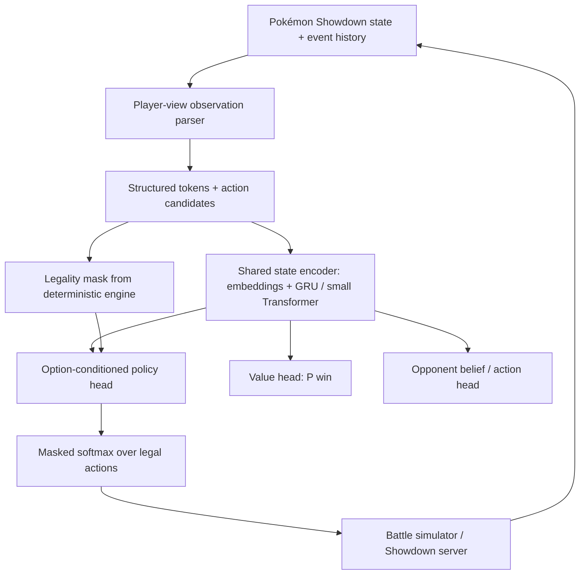

# Building a Jev-like Pokémon Showdown AI

*Technical research & design proposal — Nghiên cứu model quyết định, kiến trúc đề xuất, chiến lược train và lộ trình triển khai cho Gen 9 OU Singles.*

> **Kết luận khuyến nghị.** Xây một structured-state actor–critic nhỏ với option-conditioned action scorer, value head và opponent head. Dùng Metamon làm nền tảng dữ liệu/đánh giá; tham khảo Kev và Laya cho cách tính xác suất hành động, Jaxcalibur cho self-play và hidden-information modeling.

**Phạm vi:** Pokémon Showdown · Gen 9 OU Singles · 1 GPU thử nghiệm · research prototype  
**Cập nhật:** 16/10/2026  
**Mức độ xác minh:** Ưu tiên paper peer-reviewed, README và model code chính chủ; phân biệt kết quả nhóm tác giả công bố và mục tiêu dự kiến.

## 1. Executive summary

Có thể tự build và train một model theo tinh thần “System One” để chơi Pokémon Showdown. Bài toán hợp với mô hình ra quyết định trực tiếp hơn là LLM tạo văn bản vì mỗi lượt có một tập action hợp lệ, battle state có cấu trúc, và có thể đo kết quả bằng win/loss. Tuy nhiên, xác suất chọn hành động không đồng nghĩa với xác suất hành động đó sẽ đem lại chiến thắng.

Khuyến nghị ưu tiên Gen 9 OU Singles trong phiên bản đầu tiên. Format này được Metamon hỗ trợ, cùng replay datasets, action space 13 lựa chọn cho lượt đấu thông thường, pretrained baseline và training/evaluation scripts \[06\]. Nếu muốn chuyển sang Gen 9 Random Battle, cần thay dữ liệu và giao diện môi trường; Jaxcalibur chỉ là tham khảo phương pháp, không phải checkpoint công khai \[08\].

> **Quyết định kiến trúc.** V0: state encoder + GRU (hoặc Transformer nhỏ) + masked action scorer + value head. V1: thêm opponent head và self-play league. V2: bổ sung search có điều kiện khi gặp vị trí chiến thuật khó. Không cần fine-tune LLM 4B–9B ở giai đoạn đầu.

### Các phát hiện đáng tin cậy

Jev của TypeSafe giới thiệu typed decisions và calibrated probabilities; trọng tâm là giao diện suy luận, còn chi tiết backbone/weights chưa công bố đầy đủ \[01\].

Kev, Laya, Nimble và tev1 công bố code/weights/recipe cho decision modeling; phần lớn benchmark là classification trên văn bản, không chứng minh năng lực chơi Pokémon \[02–05\].

Metamon cung cấp 5M+ reconstructed human trajectories, 20M+ self-play trajectories và 40+ baseline policies theo repo hiện tại \[06\].

Jaxcalibur công bố policy 8,5M tham số, PPO tự đấu và search khi inference; tác giả chưa phát hành weights/source, hiệu năng công bố thuộc Gen 9 Random Battle, không trực tiếp so với Gen 9 OU \[08\].

## 2. Model landscape và mức độ liên quan

| **Project**               | **Cái có thể học**                                                              | **Lưu ý quan trọng**                                                                           |
|---------------------------|---------------------------------------------------------------------------------|------------------------------------------------------------------------------------------------|
| **Jev / TypeSafe**        | Typed Choice / Score / Noul; output probabilities; one-call decision interface. | Black box. Không sao chép được kiến trúc nội bộ từ mô tả marketing \[01\].                     |
| **Kev**                   | Pointer head: score lựa chọn với hidden state, LoRA; probability calibration.   | Backbone dạng text LLM vẫn đắt hơn neural state encoder nhỏ \[02\].                            |
| **Laya**                  | Bidirectional encoder chấm nhiều options trong một pass.                        | Checkpoint được train cho text; cần domain adaptation \[03\].                                  |
| **Nimble / tev1**         | Dataset recipe, hard-label fine-tune, held-out evaluation.                      | Nimble có dữ liệu synthetic quy mô nhỏ; không có nhãn “best move” chuẩn cho Pokémon \[04–05\]. |
| **Metamon**               | Replay reconstruction, 13-action interface, baselines và policy checkpoints.    | Dữ liệu và format hỗ trợ khác nhau theo model \[06–07\].                                       |
| **Jaxcalibur**            | State tokens, auxiliary prediction heads, PPO và test-time search.              | Chưa open weights; mô tả thành tích là self-reported \[08\].                                   |
| **Foul Play / PokéChamp** | Search, opponent modeling và tactical evaluation.                               | Foul Play phù hợp làm đối thủ; PokéChamp là hệ LLM + minimax \[10–11\].                        |

## 3. Định nghĩa bài toán đúng

Pokémon Singles là trò chơi hai người có thông tin không đầy đủ, cơ chế ngẫu nhiên và phần lớn lượt chọn hành động đồng thời. Mô hình chỉ được nhìn thấy thông tin hợp lệ theo góc nhìn người chơi: Pokémon và moves của mình, thông tin đối thủ đã lộ, field, weather, hazards, trạng thái và lịch sử. Nó không được đọc moveset/item/tera type ẩn của đối phương từ replay tương lai \[07, 08\].

### Ba xác suất phải phân biệt

| **Đại lượng**             | **Ý nghĩa**                                                  | **Dùng làm gì**                                  |
|---------------------------|--------------------------------------------------------------|--------------------------------------------------|
| **Policy π(a\|o,h)**      | Xác suất agent chọn action a với observation o và lịch sử h. | Sampling action, policy loss, exploration.       |
| **Value V(o,h)**          | Dự đoán xác suất thắng từ trạng thái/lịch sử hiện tại.       | Critic; đánh giá tình thế; calibration.          |
| **Opponent p(aₒₚₚ\|o,h)** | Dự đoán hành động hoặc hidden set của đối thủ.               | Dự báo switch/move, search qua nhiều giả thuyết. |

Không nên gắn nhãn “Thunderbolt: 62% chance of winning” cho output softmax của action scorer. Đó chỉ là phân phối lựa chọn (hoặc preference) trừ khi model được train/đánh giá riêng để ước lượng win probability có điều kiện theo từng action.

### Không gian hành động

Đối với Gen 9 OU, Metamon công khai UniversalAction 13 slots: 4 moves, 5 switches và 4 biến thể move + Terastallization \[06\]. Mỗi lượt có action mask loại bỏ những lựa chọn không hợp lệ (fainted, trapped, hết PP, chưa được Tera, v.v.). Team preview và trường hợp bất thường phải xử lý bằng adapter riêng, không mặc định 13 slots áp dụng cho mọi giai đoạn.

## 4. Kiến trúc kỹ thuật đề xuất



*Hình 1. Sơ đồ logic đề xuất: shared encoder, policy/value/opponent heads, legality và battle simulator là deterministic code.*

### Observation encoder

Mỗi Pokémon dùng ID embeddings cho species, item/ability đã biết, types, move IDs, Tera information đã lộ; numerical features gồm HP, stat stages, status, PP, remaining team size, turn count. Field tokens chứa hazards/weather/terrain/screens. Last 8–16 events đóng vai trò history tokens. Vì số lượng Pokémon và candidate moves giới hạn, một encoder nhỏ có thể học được cấu trúc chiến thuật mà không cần nhập toàn bộ battle state dạng prose.

### Shared memory và action scorer

V0 dùng embeddings + MLP hoặc small Transformer với GRU theo lượt. Shared state vector được so sánh với action embedding, tương tự cơ chế pointer scoring của Kev \[02\]. Mô hình tạo logits cho action hợp lệ, đặt logits của action bất hợp lệ thành −∞ trước khi softmax. Tạo các heads phụ cho value và opponent belief trong cùng forward pass.

```text
s = Encoder(observation, history_hidden)
e_a = ActionEncoder(legal_actions, candidate_features)
logits[a] = dot(Wq(s), Wk(e_a)) / sqrt(d)
logits[~action_mask] = -inf
policy = softmax(logits / temperature)
win_probability = sigmoid(ValueHead(s))
opponent_distribution = softmax(OpponentHead(s))
```

### Lộ trình tăng độ phức tạp

V0 ưu tiên độ đúng của parser + legal action mask và điểm số baseline. Chỉ nâng lên 5–20M parameters khi có bằng chứng rằng capacity là bottleneck. V1 thử auxiliary opponent head và lịch sử dài hơn. V2 dùng tactical search trên một tập nhỏ trạng thái khó; search nên dùng belief sampling để không lộ thông tin ẩn \[08, 10–11\].

## 5. Dataset và chống data leakage

### Nguồn và độ ưu tiên

| **Nguồn**                     | **Vai trò**                                       | **Cần kiểm soát**                                                  |
|-------------------------------|---------------------------------------------------|--------------------------------------------------------------------|
| **Metamon parsed replays**    | Supervised imitation + offline RL \[06\].         | Split theo battle ID, thời gian và format; observer-perspective.   |
| **Human high-rating subsets** | Expert demonstrations và tactical examples.       | Rating, thời kỳ metagame, diversity; tránh chỉ học một team.       |
| **Self-play trajectories**    | Policy improvement và league training.            | Opponent pool đa dạng; versioning; không train từ policy duy nhất. |
| **Engine-generated signals**  | Legal actions, expected damage, tactical teacher. | Không để dùng thông tin mà thực tế agent không thể biết.           |

### Schema đề xuất cho mỗi timestep

```json
{
"battle_id": "<unique_id>", "turn": 12,
"format": "gen9ou", "player_view": "p1",
"observation": {"own_team": "...", "revealed_opp": "...",
"field": "...", "events": "..."},
"legal_actions": ["move:earthquake", "switch:rotomwash", "..."],
"action_mask": [1, 0, 1, 1, 0, 0, 0, 0, 0, 1, 0, 0, 0],
"chosen_action": "switch:rotomwash",
"final_result": "win", "policy_version": "human_replay"
}
```

Ví dụ schema minh họa; action labels được adapter chuyển thành UniversalAction IDs theo format thực tế.

### Checklist bắt buộc cho parser

Khôi phục observation từng lượt từ first-person view, không từ spectator omniscience; test bằng replay vốn có hidden information.

Không có nhãn action sai format; legal-mask khớp engine tuyệt đối; team preview và forced switch được test riêng.

Split toàn bộ timesteps của một battle vào cùng một tập; freeze validation/test trước khi train; kiểm tra trùng replays.

Giữ lại season/metagame/team archetypes ít gặp làm out-of-distribution evaluation; theo dõi bias của dữ liệu chiến thắng.

## 6. Training strategy

### Phase A: Imitation Learning / Behavior Cloning

Bắt đầu với subset 100k–500k decision points từ Gen9 OU đã được lọc, không cần tải/đọc toàn bộ 5M+ trajectories ngay. Train masked cross-entropy trên action mà người chơi đã chọn. Có thể ưu tiên replay high-rating nhưng cần giữ đa dạng team và tình huống. Train một value head phụ dự đoán terminal outcome; label giá trị được lấy từ kết quả trận đấu, không thay thế policy loss.

```text
L_BC = - mean(log pi_theta(action_t | observation_t, history_t))
L_value = BCE(V_theta(observation_t), final_win_label)
L_aux = CE(opp_head, revealed_future_opp_action) # only valid labels
L_total = L_BC + lambda_v * L_value + lambda_o * L_aux
```

BC học phân phối hành động của human demonstrations, không trực tiếp học optimal action. Win-conditioned filtering có thể làm lệch dataset vì team strength, matchup và may mắn. Do đó chỉ dùng top-player data như một tín hiệu, không tuyên bố mọi nước đi được gắn nhãn đều tối ưu.

### Phase B: Offline improvement

Sau baseline BC, thử advantage-weighted behavior cloning hoặc offline actor–critic trên trajectory có rewards. Bắt đầu bằng ablation đơn giản: BC-only vs BC+value vs BC+opponent. Offline RL có rủi ro extrapolation trên actions ít xuất hiện; mọi cải thiện phải đo bằng win rate trong simulator, không chỉ giảm validation loss. Metamon có sẵn config và pipeline offline RL qua amago \[06–07\].

### Phase C: Self-play reinforcement learning

Tạo league có random, heuristic, nhiều checkpoint cũ của chính model và một số đối thủ chiến thuật mạnh. Train bằng PPO/GAE (hoặc tiếp tục RL pipeline của Metamon), lấy outcome terminal làm reward chính; shaping nhẹ cho HP/status chỉ dùng nếu ablation cho thấy có ích. Jaxcalibur cho thấy có thể train policy nhỏ với PPO và các auxiliary heads, nhưng mức hàng chục triệu trận self-play yêu cầu simulator thông lượng rất cao \[08\].

Đừng lấy “1 tuần trên H100 gần 100M self-play battles” của Jaxcalibur làm ngân sách bắt buộc cho MVP: họ có GPU-vectorized simulator tự viết bằng JAX, khác hoàn toàn việc dùng local Showdown server qua Python \[08\]. Ban đầu bottleneck có thể là môi trường, không phải GPU.

## 7. Evaluation protocol

### Định nghĩa thành công

| **Metric**                | **MVP gate (đề xuất)**                    | **Đo thế nào**                                         |
|---------------------------|-------------------------------------------|--------------------------------------------------------|
| **Invalid-action rate**   | 0% trên test suite.                       | Replay 10k+ lựa chọn qua legality adapter.             |
| **Win rate vs heuristic** | \> 55% trên fixed test mix.               | Ít nhất 400 trận / opponent chính; paired seeds/teams. |
| **Improvement vs BC**     | \+ 5 điểm % khi thêm RL (stretch goal).   | A/B cùng team sets và đối thủ cố định; CI 95%.         |
| **Value calibration**     | Brier / ECE tốt hơn baseline naïve.       | Holdout battles, reliability diagram theo stage.       |
| **Inference latency**     | \< 50 ms local model pass (aspirational). | p50/p95 đo cùng hardware, không tính simulator.        |
| **Hidden-info leakage**   | 0 test case lộ hidden fields.             | Snapshot observation và adversarial replay tests.      |

Các giá trị là engineering acceptance criteria do report đề xuất, không phải benchmark đã đạt.

Bài test ladder cần báo cả Elo/GXE, win rate theo đối thủ, team-robustness và độ tin cậy thống kê. Với win rate gần 50%, 400 trận độc lập có sai số xấp xỉ ±5 điểm phần trăm ở mức 95%; thực tế cần thêm vì matchup/team và policy versions tạo tương quan. Nên đánh giá cross-play và giữ một holdout set thực sự không dùng khi chọn checkpoint.

### Mốc ablation phải có

State encoder: MLP vs GRU vs mini Transformer; cùng số training decisions.

Action head: fixed 13-way classifier vs option-conditioned scorer.

BC vs BC + value vs BC + opponent predictions vs self-play RL.

History length: 0, 4, 16 recent events; team and metagame splits.

Search off vs shallow search on difficult states; đo Elo gain và cost/turn.

## 8. Roadmap triển khai 8 tuần

| **Giai đoạn**            | **Deliverables**                                                     | **Exit gate**                                       |
|--------------------------|----------------------------------------------------------------------|-----------------------------------------------------|
| **W1 — Environment**     | Local Showdown, poke-env/Metamon, fixed Gen9OU teams, baselines.     | 1k local battles tự động, log chuẩn và không crash. |
| **W2 — Parser**          | Replay → observation/action dataset; masked legal action unit tests. | 100% sampled records hợp lệ, 0 hidden-info leak.    |
| **W3 — First policy**    | Small MLP/GRU + masked 13-action BC.                                 | Vượt random/naïve heuristic ở test mix.             |
| **W4 — Robustness**      | Value head, history; frozen evaluation harness, CI.                  | BC ổn định qua seed, team và opponent mix.          |
| **W5–6 — Self-play**     | League, PPO/offline RL, opponents đa dạng, checkpoint registry.      | Win rate tốt hơn BC trên holdout.                   |
| **W7 — Belief / search** | Opponent head, optional shallow Foul Play integration.               | Ablation chứng minh cải thiện thực tế.              |
| **W8 — Release**         | API, model card, test matrix, performance report.                    | 0 invalid action, reproducible eval.                |

Nếu chỉ có 4 tuần, chốt MVP ở cuối W4. Nếu target là top ladder, scope sẽ chuyển thành bài toán research nhiều tháng, yêu cầu đầu tư simulator throughput và cross-play evaluation lớn hơn.

## 9. Compute, hardware và chi phí

| **Mức**       | **Cấu hình hợp lý**                                 | **Hướng làm / rủi ro**                                        |
|---------------|-----------------------------------------------------|---------------------------------------------------------------|
| **Prototype** | CPU + GPU 8–12 GB (nếu sẵn có).                     | Feature/parser + MLP/GRU nhỏ; có thể chậm khi train lớn.      |
| **MVP**       | 1 GPU 24 GB + nhiều CPU cores cho simulator.        | BC và fine-tuning mô hình 1–20M dễ khả thi hơn LLM 4–9B.      |
| **Scale-up**  | H100 80 GB hoặc tương đương; engine throughput cao. | PPO/self-play quy mô lớn; simulator và debugging là nút thắt. |

Tham chiếu giá Runpod cập nhật 15/10/2026: A5000 24 GB \$0,27/giờ, RTX 4090 24 GB \$0,89/giờ, H100 PCIe \$2,89/giờ và H100 SXM \$3,99/giờ (mức Secure Cloud trong bảng do nhà cung cấp công bố, có thể đổi theo thời gian) \[13\].

Kế hoạch ngân sách thử nghiệm: dành 20–80 GPU-hours cho baseline + ablations, tương đương khoảng \$5–\$71 nếu chỉ nhân với khoảng giá 24 GB nói trên; chưa gồm CPU simulator, storage, tải dữ liệu, lỗi thử nghiệm và công sức kỹ thuật. Dành ngân sách bổ sung theo hiệu suất games/giờ đo được, thay vì dự trù “100 triệu game” ngay từ đầu.

> **Điểm thường bị đánh giá thấp.** Tốc độ chạy game state transitions, parser và chất lượng dữ liệu có thể quyết định chi phí nhiều hơn số parameters. Hãy benchmark games/second và decisions/second từ tuần 1 trước khi mua GPU lớn.

## 10. Rủi ro và cách kiểm soát

| **Rủi ro**                     | **Tác động**                                          | **Biện pháp**                                          |
|--------------------------------|-------------------------------------------------------|--------------------------------------------------------|
| **Future information leakage** | Model có thể “đọc trước” moves/items của đối thủ.     | Reconstruct player-view; adversarial replay tests.     |
| **BC ≠ optimal play**          | High action accuracy nhưng chiến thuật yếu.           | Đo win rate; thêm RL/value; đánh giá long horizon.     |
| **Simultaneous decisions**     | Dự đoán “best move” đơn lẻ bị sai khi đối thủ switch. | Opponent policy + mixed strategy; robust search.       |
| **Reward hacking**             | Agent farm damage/HP thay vì kết thúc trận.           | Terminal win reward là mục tiêu chính; ablate shaping. |
| **Metagame drift**             | Patch/usage thay đổi, model lệch phân phối.           | Time-based holdout và định kỳ retrain/eval.            |
| **Engine/API mismatch**        | Illegal action hoặc game state drift.                 | Unit tests theo phiên bản engine; 0 invalid policy.    |
| **Community fairness**         | Bot spam public ladder / tạo lợi thế không công bằng. | Train trên local server; tuân thủ quy định platform.   |

## 11. Các quyết định cần chốt trước khi code

1. **Format:** Gen9 OU Singles (chốt cho V0) hay Gen9 Random Battle? Đây là quyết định có tác động lớn nhất tới dataset, state encoder và game mechanics. 
2. **Đích sản phẩm:** practice bot, ladder bot hay research benchmark? 
3. **GPU và ngân sách:** Chạy trên GPU nào và budget thí nghiệm? 
4. **Giải thích:** Cần giải thích nước đi bằng text không? Nếu cần, thêm một explanation layer bên ngoài policy, không gộp vào decision model.

### Khuyến nghị cuối cùng

Bắt đầu từ Metamon + small masked policy, tự xây một action scorer kiểu Kev trên state embeddings. Sau khi baseline chạy được và đã có test harness đáng tin, mới thêm GRU/history, value calibration và opponent modeling. Chỉ thêm search sau khi biết rõ nó đem lại điểm Elo đủ lớn so với latency và compute. Nhờ cách chia giai đoạn này, project có kết quả đo được sau vài tuần thay vì biến thành việc “train một Jev mới” mơ hồ.

## 12. Appendix A: Project structure

```text
pokemon-decision-ai/
├── env/
├── data/
├── models/
├── train/
│   ├── bc.py
│   └── self_play.py
├── eval/
│   └── eval.py
├── tests/
├── configs/
├── checkpoints/
└── docs/
```

*Thêm `data/replay_parser.py` để tái dựng observation từ replay.*

## Appendix B: Nguồn và chú giải bằng chứng

Phân hạng nguồn: paper phản biện khoa học cung cấp nền tảng mạnh cho phương pháp \[07, 11\]; code và README chính chủ mô tả chức năng tái hiện được nhưng benchmark thường tự báo cáo \[02–06, 08–10\]; giá thuê GPU \[13\] chỉ là ảnh chụp theo thời điểm, không phải báo giá cố định.

**\[01\] TypeSafe AI (15/09/2026).** Introducing System One Models & Jev. [Mở nguồn](https://typesafe.ai/blog/introducing-system-one-models-and-jev)  
Primary source: giao diện và khẳng định hiệu năng Jev; kiến trúc chi tiết chưa công khai.

**\[02\] Jared Palmer.** Kev - GitHub repo và model cards. [Mở nguồn](https://github.com/jaredpalmer/kev)  
Pointer head, LoRA, option scoring, model sizes và calibration.

**\[03\] NandhaKishorM.** Laya - GitHub repository. [Mở nguồn](https://github.com/NandhaKishorM/laya)  
Encoder non-autoregressive, typed decision interface và fine-tuning.

**\[04\] Bespoke Labs.** Nimble - Data, Model, Recipe. [Mở nguồn](https://github.com/bespokelabsai/nimble)  
LoRA fine-tuning, synthetic data, held-out eval và giới hạn của dữ liệu.

**\[05\] Together AI.** tev1-4B-experimental. [Mở nguồn](https://github.com/togethercomputer/tev1)  
Recipe fine-tune mô hình lựa chọn bằng nhãn cứng.

**\[06\] UT Austin RPL.** Metamon - code, data, baselines. [Mở nguồn](https://github.com/UT-Austin-RPL/metamon)  
Hạ tầng dữ liệu, 13 hành động chuẩn Gen9 OU, pretrained policies và train scripts.

**\[07\] Grigsby et al. (RLC 2025).** Human-Level Competitive Pokémon via Scalable Offline RL with Transformers. [Mở nguồn](https://rlj.org/papers/grigsby2025human)  
Paper peer-reviewed về replay reconstruction, transformer policy, offline RL, self-play.

**\[08\] Jaxcalibur (2026).** How Jaxcalibur works. [Mở nguồn](https://jaxcalibur.github.io/)  
Chi tiết tác giả tự công bố về policy 8.5M, auxiliary heads, PPO, search, training cost.

**\[09\] Haris Sahovic.** poke-env - Python interface. [Mở nguồn](https://github.com/hsahovic/poke-env)  
Tạo agent, local battles và Gymnasium RL environment.

**\[10\] Patrick Mariglia.** Foul Play - Showdown battle AI. [Mở nguồn](https://github.com/pmariglia/foul-play)  
Strong search-based comparison bot, Rust battle engine.

**\[11\] Karten et al. (ICML 2025).** PokéChamp: An Expert-level Minimax Language Agent. [Mở nguồn](https://proceedings.mlr.press/v267/karten25a.html)  
LLM kết hợp minimax, opponent modeling, value estimation trong Gen9 OU.

**\[12\] Smogon.** Pokémon Showdown simulator. [Mở nguồn](https://github.com/smogon/pokemon-showdown)  
Engine và local self-play; các luật hành động chính thức.

**\[13\] Runpod (15/10/2026).** AI server cost and cloud GPU prices. [Mở nguồn](https://www.runpod.io/articles/guides/ai-server-cost)  
Mốc giá GPU công khai để lập ngân sách; có thể thay đổi.

**\[14\] Smogon.** Pokémon Showdown replay API. [Mở nguồn](https://github.com/smogon/pokemon-showdown-client/blob/master/WEB-API.md)  
Thông tin định dạng replay và JSON; Metamon đã có parser tốt hơn cho training.